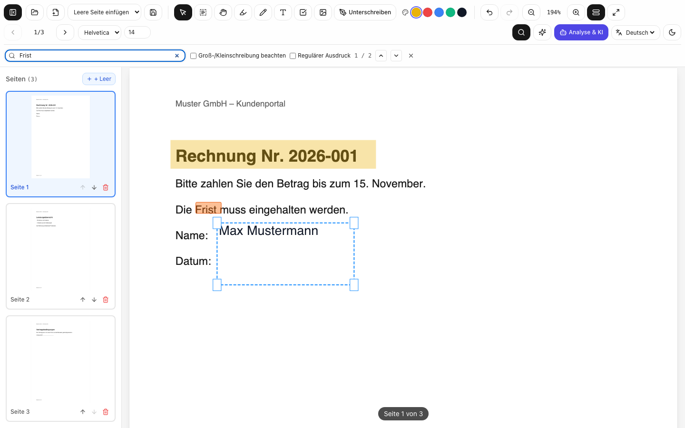

# PDF Studio

A PDF editor that runs in the browser or as a desktop app (Tauri). PDFs are processed locally; nothing is uploaded unless an AI provider is configured.

Demo: https://justus-dev02.github.io/pdf-studio/



## Features

- View PDFs with zoom, fit-to-width/page and a thumbnail sidebar
- Annotate: highlights, freehand, text boxes, check marks, images, signatures
- Add, reorder and delete pages, with undo/redo
- Full-text search (plain, case-sensitive, regex)
- Export with annotations flattened into the PDF
- Autosave to IndexedDB, session restore after reload
- Text analysis (language, readability, key terms) and PDF → Markdown
- Optional summaries and Q&A via a local OpenAI-compatible server (LM Studio, Ollama) or Gemini
- German and English UI

## Tech stack

React 18, TypeScript, Zustand, Tailwind CSS, pdf.js, pdf-lib, zod, Vite, Tauri 2, Rust, Vitest, Playwright

## Getting started

Requires Node.js ≥ 20.19. For the desktop app also Rust and the [Tauri prerequisites](https://v2.tauri.app/start/prerequisites/).

```bash
npm ci
npm run dev          # http://localhost:5173
npm run tauri:dev    # desktop app
```

With Docker:

```bash
docker compose up --build   # http://localhost:8080
```

To use a local LLM, start LM Studio or Ollama with CORS enabled for the app origin and select it under **Analyse & KI → KI-Anbieter**. A Gemini API key can be entered there as well; it is kept in `sessionStorage` only.

## Development

```bash
npm run ci          # typecheck, lint, unit tests, build
npm run test:e2e    # Playwright
npm run test:rust   # Rust tests
```

## Project structure

```
src/
├── app/          App shell
├── components/   Shared UI components
├── features/     Viewer, toolbar, sidebar, search, document handling, assistant
├── i18n/         Translations
├── services/     PDF, analysis, LLM and persistence logic (no React)
└── store/        Zustand store
src-tauri/        Desktop shell and Rust analysis engine
tests/            E2E tests and fixtures
```

## Known limitations

- Encrypted PDFs can be viewed but not exported.
- Annotations are flattened, not saved as editable PDF annotations.
- Export supports standard PDF fonts only; unsupported characters become `?`.
- No OCR: scanned pages cannot be searched or analyzed.
- Form field detection is heuristic.
- The Gemini key is used directly from the browser. A multi-user deployment would need a server-side proxy.

## License

MIT
